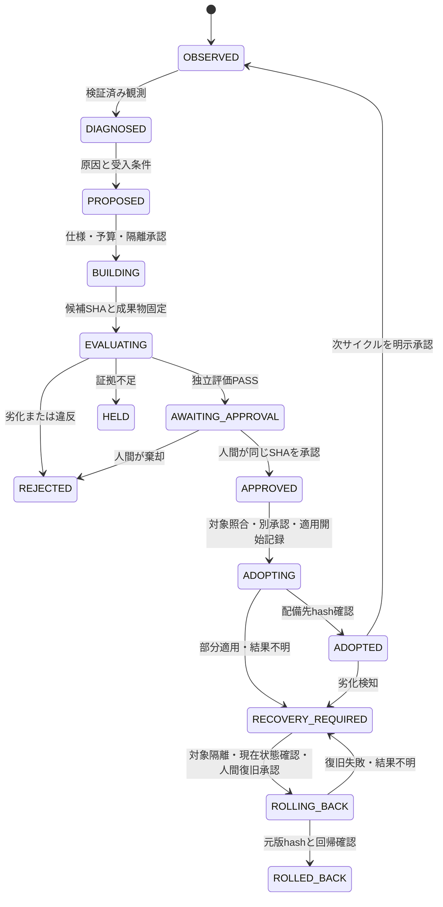

# Hermes自己改善の基本設計案

合成データと無害なスキル候補で、観測→診断→提案→隔離実装→独立評価→人間承認の1サイクルを構成する。
本番採用はPRのMergeとは別の承認と作業に分ける。LLMの重み更新は扱わない。
これは [Issue #2](https://github.com/second-works/hermes-self-improvement/issues/2) のレビュー用設計案であり、実行・権限追加・本番採用の承認ではない。

Risk Tier: HIGH。権限・外部送信・採用境界を設計するため。今回の変更は文書3点のみで、既存安全規則・workflow・実行コードは変更しない。
前提はIssue #1完了、基準main `b6b41c3e9d367a65a4082e5bd27b5ffd0d81eb46`。未承認の重要判断は [roadmap](roadmap.md) の実装前条件で停止する。

## 責務と配置

以下のパスは将来の配置案であり、今回作成・取得しない。

| 対象 | 責務・配置案 | 境界 |
| --- | --- | --- |
| Hermes本体 | upstreamの固定SHAを隔離環境へ取得 | 本番 `~/.hermes` の読取・変更・起動は禁止。upstream修正は別Issue |
| 拡張コード | このrepoの `src/` に制御・入力検証・評価連携 | 本体のvenv、設定、認証、サービスと分離 |
| スキル | `fixtures/skills/` の無害な基準、候補は `runs/<run_id>/candidate/` | 実行対象は承認済みパスのみ。本番スキルは対象外 |
| 評価データ | `fixtures/evaluation/` に公開train/validation、隔離評価者にhiddenセット | 候補生成者へhidden入力・正解・個別traceを渡さない |
| 改善履歴 | `runs/<run_id>/` のmanifest・イベント・レポート | 原本保持、Secrets・会話履歴を含めない。GitHubには検査済み要約のみ |
| 採用台帳 | SHA、評価、承認、配備、復旧の対応 | 正本は改ざん検出可能なファイルとGitHub証跡。Memoryだけに依存しない |

サブエージェントは限定した候補作成、Codexは仕様整理・差分・レビュー対応、独立評価者は判定を担う。生成者は評価閾値・hiddenセット・承認記録を変更できない。
GitHub ActionsはGitHub-hosted runnerで無害なfixtureとrepo検証のみを実行し、Hermes本番やホストの個人データに接続しない。
Memoryは履歴の検索用の補助で、承認や成功状態の正本ではない。Cronは将来の診断・提案通知まで。Dockerは後続Issueで隔離を検証してから利用し、単独では安全を保証しない。[security-model](security-model.md) を適用する。

## 状態と1サイクル

対象への書込開始前の非終端状態では、予算・期限・隔離違反・取消・異常終了で `STOPPED` へ移る。`ADOPTING / ROLLING_BACK` の書込開始後または書込有無が不明な失敗は `RECOVERY_REQUIRED` にする。制御側は書込前に状態と対象・元版snapshotを永続化し、再起動後に未完了の採用/復旧intentを見つけた場合も `RECOVERY_REQUIRED` とする。対象を隔離して新規採用を禁止し、人間が現在状態と復旧元を確認・承認するまで復旧を実行しない。`STOPPED / HELD / REJECTED / ROLLED_BACK / RECOVERY_REQUIRED` は自動再開しない。
PRのMergeは `APPROVED` の証跡にできるが、`ADOPTED` には配備先の実体確認が必要。今回のIssue #2は文書作成だけで、状態機械を実行しない。後続の候補作成・評価段階（#5/#7）はPASS時の `AWAITING_APPROVAL` まで。#8では別々の必須試験として、承認・模擬採用シナリオを `ADOPTED`、故障注入・復旧シナリオを `ROLLED_BACK` まで検証する。#8全体のDoneは両試験の成功であり、単一状態で表さない。#9の最小fixtureサイクルは `OBSERVED` → `ADOPTED` の1サイクルとし、別の故障注入・復旧試験を `ROLLED_BACK` まで再検証する。本番採用はすべてのfixture再現試験の対象外。

最小例は、匿名のPRパッチから問題を抽出するテスト用スキル。失敗fixture1件を観測し、手順不足を診断し、仕様を固定して候補1件を作る。独立評価者が同じ環境の基準と候補を比較し、PASSなら差分・結果・未確認事項をPRに添えて人間判断へ渡す。劣化版も評価し、必ず棄却できることを確認する。fixture用の承認・模擬採用と別の復旧試験は#8で検査し、#9で観測から模擬採用まで接続して復旧試験も再検証する。復旧試験は採用後劣化と部分適用失敗の両方を扱い、いずれも本番を使わない。

## 入出力契約

形式はUTF-8 JSON、schema_version `1` の案。外部入力を境界で検証して状態別レコードへ変換する。未定義状態・未知schema・欠損・非有限数値・パス逸脱は受理しない。

| レコード | 必須内容 | 次工程に渡すもの |
| --- | --- | --- |
| observation | run_id、issue_url、UTC日時、fixture_id、source_sha、失敗分類、根拠参照、情報分類 | 診断用に検査済みの観測 |
| proposal | 基準SHA、変更allowlist、原因・確度、Done、公開評価ID、budget、依存状態、承認参照 | 候補作成仕様。hidden情報なし |
| candidate | run_id、親proposalのhash、基準SHA、候補SHA、diff hash、環境image digest、変更パス、単体検証結果 | immutableな候補と公開trace |
| evaluation | 両SHA、dataset hash、環境・model revision、seed、件数、各指標、PASS/FAIL/HOLD、理由、評価者ID | 検査済み集計。hiddenの個別結果は非公開 |
| approval | 人間ID、UTC日時、候補SHA・評価hash、操作、environment_id、target_id、制御側登録root内の正規化済みartifact相対path、許可期限。採用承認には期待する基準SHAと採用前artifact hash、候補artifact hashも固定 | Merge承認と採用承認を別レコードにする。承認targetとlock・実配備先の一致必須 |
| adoption / rollback | approvalと同じenvironment_id・target_id・artifact path、基準SHA・候補SHA、採用前後artifact hash、バックアップ参照、承認参照、実施・確認結果。復旧承認には観測済みの現在状態（通常ファイルのhash、または欠如）と復旧先の基準SHA・artifact hashを固定 | 検証済み基準版と監査履歴。不明な現在状態のまま復旧しない |

SHAは完全なGit commit SHA、データ・diff・レコードはSHA-256で識別する。候補SHA変更で評価と承認は失効する。情報分類は `PUBLIC / INTERNAL / CONFIDENTIAL`、未確定は厳しい側に扱う。
候補artifact pathは指定runディレクトリ内の通常ファイルだけを受理する。配備先は制御側に登録したfixture rootとtarget_idで決まり、承認票のenvironment_id・target_id・正規化済み相対pathがlockと実配備先の全項目に一致することを必須とする。同じ配備先を別target_idで登録せず、同一hashでも別targetの承認を流用しない。絶対パス、`..`、symlink、特殊ファイル、予期しないサイズ・文字列を拒否し、書込直前にも配備先の境界を確認する。候補の任意コマンドを制御側で実行しない。
出力欠如・不正JSON・終了code不一致は失敗。stdoutの「成功」文だけで状態を進めない。

## 制御上限の提案

| 制御 | 最小fixtureサイクル案 | 実装要件 |
| --- | --- | --- |
| 反復 | 1、候補1件 | Issue #9の手動ループは最大3を候補値とし、5への拡大は別承認 |
| 再試行 | 通信の一時障害のみ1回 | 新候補生成、FAIL/HOLD、権限・認証エラーを自動再試行しない |
| 同時実行 | 全体1、子worker1 | 親子すべてを同じ予算に集約 |
| 時間 | 全体20分、子処理5分以下か残り時間 | monotonic deadline、子processも停止。kill不能は隔離異常 |
| API費用 | 初期fixtureは0 USD、API実験の提案上限1 USD/run | provider・モデル・単価・送信内容の別承認が必要 |
| API呼出数 | 承認後も最大20/run（評価・再試行含む） | 費用上限との先着停止。見積り不能なら呼び出さない |

API実験では呼出前に最大入力/output token費用を予約し、並列・retryも含め精算する。単価または使用量不明はHOLD。上限値は公式の推奨値ではなく、このprojectの未承認提案。
run開始時に `(target_id, baseline_sha, proposal_hash)` の排他lockを原子的に確保し、run_id・所有者・期限を記録する。同一キーは既存結果を返し二重起動しない。採用・復旧は登録済みenvironment_id/target_idと配備先path単位で排他し、承認票と同じ対象だけを許可する。
再起動で生存不明・期限切れlockを検出したら、対象書込前はSTOPPED、未完了の採用/復旧intentがある場合はRECOVERY_REQUIREDとして人間確認へ渡す。lockを自動削除して再実行せず、復旧と記録済みartifactの整合性を確認してから新runを承認する。

## 独立評価

候補生成者が使えるtrain/validationと、評価者だけが保有する未知の検証セットを分離する。同じhiddenセットを反復学習に使わず、一度判定したセットは次の候補で更新する。Memory、trace、子worker、PRからの漏洩も防ぐ。
最小fixtureでは公開10件・hidden10件を提案値とし、全必須安全ケース合格、回帰0件、hidden正答の基準比+1件以上、候補が基準と異なることをPASS条件とする。これは有限fixtureの機能確認であり、一般的な品質向上の証明ではない。

| 指標 | 比較と初期判定案 |
| --- | --- |
| 正解率 | 事前固定した期待findingとの一致。hiddenの基準・候補を同じ条件で比較 |
| 回帰・失敗率 | 必須ケースの退行0、実行失敗増加0。安全違反1件でもFAIL |
| 実行時間 | 同じ入力を各3回、medianの基準比1.2以下。timeoutはFAIL |
| API費用 | 両版の呼出別token・費用と合計。上限内かつ基準比1.2以下（基準0なら両方0） |
| 安全性 | パス逸脱、権限拡大、hidden漏洩、外部送信、未承認適用を全件拒否 |

安全違反・劣化・上限超過はFAIL。必要指標欠如、未知モデルrevision、評価汚染、サンプル不足や非決定的な品質差はHOLDで採用しない。LLM判定が必要な後続実験は盲検・複数回比較と事前の統計的基準をIssue #5で確定し、fixture閾値を流用しない。

## 公式実装とv0.21.5の調査

調査日2026-10-15。Context7で公式2repoを確認し、以下の固定公開ソースを直接照合した。本番CLIは一切起動していない。

- Hermes基準ソース: [release commit f97608f178d1ffeca59860195ab7da295f7c8e5f](https://github.com/NousResearch/hermes-agent/commit/f97608f178d1ffeca59860195ab7da295f7c8e5f)。v0.21.5タグAPIは404で、ローカル稼働版と同一SHAかは未検証。
- Self-Evolution基準: [0a929e3aa20e15cf04dc7c28492a7d41a5139125](https://github.com/NousResearch/hermes-agent-self-evolution/tree/0a929e3aa20e15cf04dc7c28492a7d41a5139125)。READMEはスキル改善を実装済み、他の改善対象を計画段階としている。[README](https://github.com/NousResearch/hermes-agent-self-evolution/blob/0a929e3aa20e15cf04dc7c28492a7d41a5139125/README.md)
- CLIは独立Python moduleで、確認した主な引数は `--skill`, `--iterations`, `--eval-source`, `--dataset-path`, `--hermes-repo`, `--run-tests`, `--dry-run`。eval-sourceはsynthetic/golden/sessiondb。これは構文の静的確認で、実行成功ではない。[CLIソース](https://github.com/NousResearch/hermes-agent-self-evolution/blob/0a929e3aa20e15cf04dc7c28492a7d41a5139125/evolution/skills/evolve_skill.py)
- Python宣言は>=3.10、DSPy>=3.0.0など下限指定でlockがなく、Hermesとの対応版保証は得られていない。[pyproject](https://github.com/NousResearch/hermes-agent-self-evolution/blob/0a929e3aa20e15cf04dc7c28492a7d41a5139125/pyproject.toml)
- 明示repo指定がない場合は本番パス探索を含む。sessiondbは複数agentの履歴を読み得るので採用しない。[config](https://github.com/NousResearch/hermes-agent-self-evolution/blob/0a929e3aa20e15cf04dc7c28492a7d41a5139125/evolution/core/config.py)
- CLIはfrontmatterを除いたbodyを構造検査へ渡し、validatorはfrontmatterを要求する。制約違反でreturnする経路があり、終了codeだけで成功判定できない。`--run-tests`はconfigへ渡されるが、このCLIの経路でtest runner呼出しを確認できない。[constraints](https://github.com/NousResearch/hermes-agent-self-evolution/blob/0a929e3aa20e15cf04dc7c28492a7d41a5139125/evolution/core/constraints.py)
- dry-runはロード後の初期確認まで。GEPA例外時の別optimizerへのfallback、出力が変化するか、候補への独立テスト、PR生成を含む全サイクルは未実証。成功文やREADMEの説明を証拠の代用にしない。

結論は「互換性未検証、直接導入を前提にしない」。Issue #6で隔離home・固定依存・明示repoパス・無害fixtureによる実証を行い、導入/ラップ/独自実装を比較する。上記CLIは調査対象で、今回実行する手順ではない。
